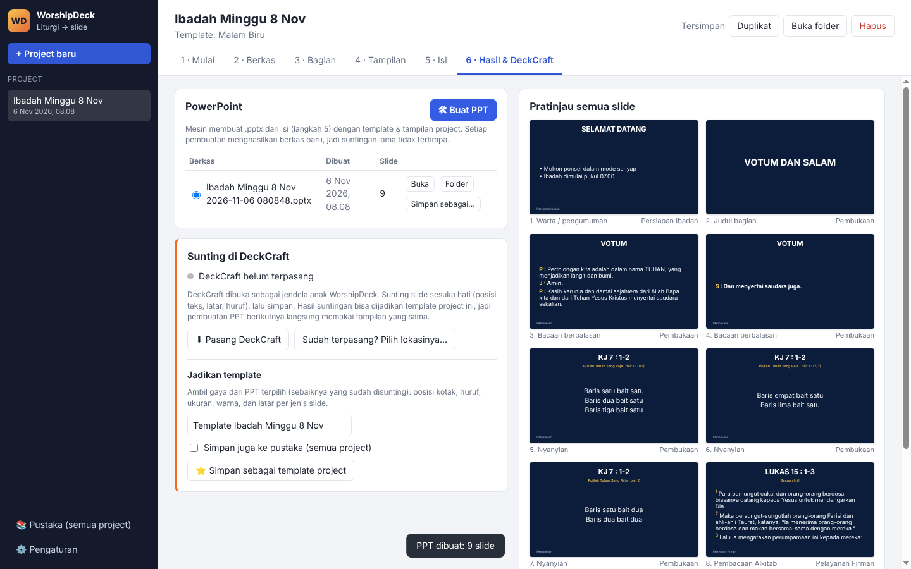

# WorshipDeck

Aplikasi Windows untuk mengubah **dokumen liturgi** (tata ibadah, warta jemaat, lirik lagu)
menjadi **slide PowerPoint** ibadah, dengan bantuan AI.

- **AI hanya menyusun isi** (JSON): urutan liturgi, lirik per bait, bacaan berbalasan, ayat, warta.
- **PPT dibuat oleh mesin**, dari JSON + template + pengaturan tampilan. Hasilnya konsisten setiap minggu.
- **[DeckCraft](https://github.com/storytold/deckcraft) menjadi "anak" WorshipDeck**: hasil PPT dibuka di
  DeckCraft untuk disunting, lalu suntingannya bisa disimpan sebagai **template project**.



## Alur kerja

| Langkah | Isi |
|---|---|
| 1 · Mulai | Nama project, tanggal, gereja, tema, pelayan firman. Pilih template & ukuran slide (16:9 / 4:3). |
| 2 · Berkas | Unggah berkas **khusus project** (PDF liturgi, warta jemaat, lirik, gambar latar). Centang "Baca AI" untuk berkas yang perlu dibaca. Berkas **pustaka** (untuk semua project, mis. kumpulan lirik KJ, logo) bisa dipilih per project. |
| 3 · Bagian | Atur bagian liturgi: urutan, aktif/nonaktif, nama, petunjuk untuk AI, slide pembatas, latar per bagian. Bisa tambah bagian sendiri. |
| 4 · Tampilan | Huruf judul & isi, ukuran (judul, teks biasa, lirik, footer), warna, perataan, latar (warna/gambar), maks. baris per slide, label P/J/S. Kosong = ikut template. |
| 5 · Isi | **Susun dengan AI** (Claude membaca berkas lalu menghasilkan JSON). JSON bisa disunting langsung. |
| 6 · Hasil | **Buat PPT**, pratinjau semua slide, buka di **DeckCraft**, simpan dari DeckCraft, dan **simpan sebagai template project** (opsional juga ke pustaka). |

Semua pengaturan project (template, tampilan, bagian, isi, daftar berkas, hasil) disimpan di folder
project itu sendiri. **Duplikat** project untuk ibadah minggu berikutnya: pengaturan, bagian, dan
template ikut tersalin, berkas dan hasil tidak.

## DeckCraft sebagai aplikasi anak

WorshipDeck menjalankan DeckCraft sebagai proses anak dengan `--control <port>` dan mengendalikannya
lewat [control protocol](https://github.com/storytold/deckcraft/blob/main/docs/control-protocol.md)
(JSON per baris di `127.0.0.1`):

- **Buka di DeckCraft** → `deckcraft --control <port> <hasil.pptx>`
- **Simpan dari DeckCraft** → `app.save` ke berkas yang sama
- Menutup WorshipDeck juga menutup DeckCraft yang dibukanya (`app.quit`)
- Saat jendela DeckCraft ditutup dan berkas berubah, WorshipDeck menawarkan menjadikannya template

Bila DeckCraft belum terpasang, tombol **Pasang DeckCraft** mengunduh versi portable dari rilis
GitHub terbaru ke folder data WorshipDeck. Lokasi DeckCraft juga bisa dipilih manual di Pengaturan.

### Template dari hasil suntingan

Mesin menandai setiap kotak teks (`wd:title`, `wd:subtitle`, `wd:body`, `wd:footer`) dan setiap slide
(catatan `wd:kind=song`, dst.). Saat PPT hasil suntingan disimpan sebagai template, WorshipDeck membaca
slide pertama tiap jenis (lagu, bacaan, berbalasan, warta, …) dan mengambil:

- posisi & ukuran kotak judul, subjudul, isi, footer
- huruf, ukuran huruf, warna, tebal, perataan
- latar slide (warna atau gambar; gambar disalin ke berkas project)

Bila penanda hilang (misalnya PPT disunting di aplikasi lain), dipakai manifest urutan slide dan
tebakan posisi kotak. Template juga bisa diambil dari berkas PPTX lain lewat **Ambil template dari PPTX…**.

## Struktur kode

```
main.js                 proses utama Electron, IPC
preload.js              jembatan aman ke jendela
lib/defaults.js         bagian liturgi, template bawaan, pengaturan bawaan
lib/schema.js           JSON Schema untuk AI + normalisasi
lib/ai.js               baca berkas (PDF/DOCX/TXT/PPTX/gambar) → Claude → JSON
lib/layout.js           JSON + template + pengaturan → slide & kotak teks (dipakai PPT dan pratinjau)
lib/engine.js           hasil tata letak → .pptx (pptxgenjs)
lib/template-import.js  .pptx hasil suntingan → template
lib/deckcraft.js        cari/unduh DeckCraft, jalankan sebagai proses anak, control protocol
lib/storage.js          project, berkas, pustaka, template di disk
src/                    antarmuka (HTML/CSS/JS tanpa framework)
test/                   tes (node --test)
```

Data tersimpan di `%APPDATA%\WorshipDeck\data`:

```
settings.json                     AI (kunci API terenkripsi), lokasi DeckCraft
library/files/, library/templates/  pustaka untuk semua project
projects/<id>/project.json        pengaturan, bagian, isi, daftar berkas, daftar hasil
projects/<id>/files/              berkas khusus project
projects/<id>/templates/          template khusus project
projects/<id>/output/             hasil .pptx (+ manifest)
```

## AI

Memakai Claude lewat SDK resmi `@anthropic-ai/sdk`. Isi kunci API di **Pengaturan**
(dibuat di console.anthropic.com; disimpan terenkripsi dengan `safeStorage`). Model bawaan
`claude-opus-5-5`; bisa diganti ke Sonnet 5.5 (lebih cepat/murah) atau Haiku 5.5.

- PDF dikirim utuh sebagai dokumen (Claude membaca tata letak PDF langsung).
- DOCX, TXT, dan PPTX lama diambil teksnya. Gambar dikirim sebagai gambar.
- Keluaran dipaksa mengikuti JSON Schema (structured output), lalu dinormalisasi lagi.
- AI diminta **tidak mengarang** lirik atau ayat; lagu yang liriknya tidak ada di dokumen tetap
  muncul sebagai slide judul dan ditandai di ringkasan.
- Untuk Opus/Sonnet, permintaan yang ditolak filter keamanan otomatis dicoba ulang dengan model cadangan
  (`fallbacks: "default"`).

## Pengembangan

```bash
npm install
```

```bash
npm start
```

```bash
npm test
```

```bash
npm run dist
```

Installer Windows dibangun otomatis oleh GitHub Actions (workflow **Build Windows**) di setiap push;
unduh artefak **WorshipDeck-Windows** dari tab Actions. Tag `v*` membuat rilis.

## Lisensi

MIT. DeckCraft adalah proyek terpisah (MIT/Apache-2.0) dari tim ArtCraft dan tidak ikut dibundel;
WorshipDeck mengunduh atau memakai DeckCraft yang terpasang di komputer pengguna.
